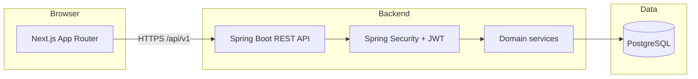

# Developer Incident Management Platform

A full-stack **incident management** application for engineering teams: organize work by **organization**, track **incidents** with severity and lifecycle, collaborate via **comments** and an immutable **timeline**, run **postmortems**, discover incidents with **filters and search**, and define **on-call rotations** with computed coverage.

The codebase is a monorepo with a **Next.js** frontend and **Spring Boot** API backed by **PostgreSQL**. It is built as a portfolio-grade engineering project with typed APIs, tenant isolation, automated tests, and phased documentation—not a hosted production product.

## Key features

| Area | Implemented | Notes |
|------|-------------|--------|
| **Authentication** | Yes | Register, login, JWT access tokens, refresh via HttpOnly cookie, logout |
| **Global user roles** | Yes | e.g. `ENGINEER`, `ADMIN` (see API docs) |
| **Organizations & membership** | Yes | Org roles: `OWNER`, `ADMIN`, `MEMBER`, `VIEWER` |
| **Teams** | Yes | Org-scoped teams and team membership |
| **Service catalog** | Yes | Org-scoped services, optional owning team |
| **Incidents** | Yes | Create, update, status/severity, commander, service link |
| **Incident timeline** | Yes | Append-only audit events; read-only UI |
| **Incident comments** | Yes | Plain text, pagination, soft delete, RBAC |
| **Postmortems** | Yes | Draft → publish → archive; org library |
| **Incident discovery** | Yes | Active/all views, filters, search, URL state, pagination |
| **On-call schedules** | Yes | Daily/weekly rotations, scope (org/team/service), coverage API & UI |
| **Escalation policies** | Planned | Phase 11 |
| **Notifications (email/Slack/etc.)** | Planned | Phase 12 |
| **Deployments correlation** | Planned | Phase 13+ |

**RBAC:** Organization **OWNER/ADMIN** manage teams, services, members, settings, on-call schedules, and most incident/postmortem mutations. **MEMBER/VIEWER** have read-oriented access where documented; the API enforces permissions (UI gating is not sufficient alone).

## Technology stack

| Layer | Technologies |
|-------|----------------|
| **Frontend** | [Next.js](https://nextjs.org/) 16, React 19, TypeScript, Tailwind CSS 4, [TanStack Query](https://tanstack.com/query), shadcn-style UI primitives |
| **Frontend tests** | Vitest (unit), Playwright (E2E) |
| **Backend** | Java 21, Spring Boot 4, Spring Security, Spring Data JPA, Bean Validation, Flyway |
| **Auth** | JWT (access) + refresh tokens; jjwt |
| **Database** | PostgreSQL 16 (Docker Compose locally) |
| **Migrations** | Flyway (`backend/src/main/resources/db/migration/V1`–`V10`) |
| **Integration tests** | Testcontainers (PostgreSQL), Mockito |
| **Local infra** | Docker Compose: PostgreSQL + Redis |
| **Tooling** | Gradle (wrapper), ESLint, Prettier |

Redis is included in Compose and the backend can open a Lettuce connection (`app.redis.*`), but **no application feature currently reads or writes Redis** (no caches, queues, or sessions stored there). Integration tests disable Redis.

## Architecture



- **Frontend** (`frontend/`): App Router pages under `/dashboard`, `/organizations/...`, auth routes; HTTP client in `src/lib/api/`; server state via TanStack Query.
- **Backend** (`backend/`): REST under `/api/v1/*`; multi-tenant checks via organization membership; Flyway applies schema on startup.
- **PostgreSQL**: Primary persistence (users, orgs, teams, services, incidents, events, comments, postmortems, on-call schedules).
- **Redis**: Started by Compose for future use; optional for local API (`REDIS_HOST` / `REDIS_PORT` in `backend/.env.example`).

More detail: [docs/architecture.md](docs/architecture.md).

## Implemented capabilities (by phase)

Summarized from [docs/development-plan.md](docs/development-plan.md). Only completed phases are described as delivered.

| Phase | Focus |
|-------|--------|
| 1 | Monorepo, Compose, API conventions, test harness |
| 2 | Auth, users, JWT, frontend auth shell |
| 3 | Organizations, memberships, teams |
| 4 | Service catalog, org dashboard, members, settings, RBAC-aware nav |
| 5–6 | Incidents, immutable timeline (`incident_events`) |
| 7 | Incident comments (separate from timeline) |
| 8 | Postmortems (draft/publish/archive, org library) |
| 9 | Incident list discovery (filters, search, pagination) — [design](docs/phase-9-incident-discovery-design.md) |
| **10** | **On-call schedules** (rotations, coverage, management UI) — **signed off 2026-10-13** — [design](docs/phase-10-on-call-design.md) |

**On-call (Phase 10) highlights:** timezone-aware daily/weekly handoffs, ordered participants, optional team or service scope, archive/reactivate, computed current/upcoming coverage (not paging or notifications).

**Not implemented:** escalation execution, notification channels, scope-based “who is on call for this service” resolver API, auto-setting incident commander from on-call, real-time coverage push.

## Prerequisites

- **Node.js** 20+ and npm
- **JDK** 21 (Gradle toolchain)
- **Docker** (PostgreSQL for local dev; Testcontainers for backend tests)
- **Chromium** for Playwright (`npx playwright install chromium` on a new machine)

## Local setup

### 1. Clone and install dependencies

```bash
git clone <repository-url>
cd incident-management-platform

cd frontend && npm install
cd ../backend && ./gradlew --version
```

### 2. Environment variables

Templates are provided in the repo (copy and edit; do not commit secrets):

```bash
# Repository root — used by docker compose
cp .env.example .env
# Set DB_PASSWORD (required by compose)

# Backend — DB, Redis, JWT, server port
cp backend/.env.example backend/.env
# Set DB_PASSWORD to match compose; set JWT_SECRET (≥ 32 characters)

# Frontend — browser API base URL
cp frontend/.env.example frontend/.env.local
# NEXT_PUBLIC_API_URL=http://localhost:8080
```

Align `DB_*` in `backend/.env` with root `.env` / Compose defaults (`incident_management`, `incident_app`, port `5432`).

### 3. Start PostgreSQL (and Redis)

From the **repository root**:

```bash
docker compose up -d
```

### 4. Start the API

From **`backend/`** (load env on macOS/Linux):

```bash
set -a && source .env && set +a
./gradlew bootRun
```

Verify:

```bash
curl http://localhost:8080/api/v1/health
```

Example response shape: `{ "status": "UP", "service": "incident-management-api" }` (see [docs/api.md](docs/api.md)).

Spring Boot Actuator: `http://localhost:8080/actuator/health` (infrastructure health).

### 5. Start the frontend

From **`frontend/`**:

```bash
npm run dev
```

Open [http://localhost:3000](http://localhost:3000). Register at `/register` or sign in at `/login`, then create or open an organization from the dashboard.

### Main UI routes (organization-scoped)

| Path | Purpose |
|------|---------|
| `/organizations/{id}` | Org overview |
| `/organizations/{id}/teams` | Teams |
| `/organizations/{id}/services` | Service catalog |
| `/organizations/{id}/incidents` | Incident list (discovery filters) |
| `/organizations/{id}/incidents/{incidentId}` | Incident detail, timeline, comments, postmortem |
| `/organizations/{id}/postmortems` | Postmortem library |
| `/organizations/{id}/on-call` | On-call schedule list |
| `/organizations/{id}/on-call/new` | Create schedule (OWNER/ADMIN) |
| `/organizations/{id}/on-call/{scheduleId}` | Schedule detail & coverage |
| `/organizations/{id}/members`, `/settings` | Membership & settings |

## Testing and quality checks

Commands are run from the directories shown. Backend integration tests need **Docker** for Testcontainers. Playwright starts (or reuses) the Next dev server and calls the API at `NEXT_PUBLIC_API_URL` (default `http://localhost:8080` in [frontend/playwright.config.ts](frontend/playwright.config.ts)).

**Backend** (`backend/`):

```bash
./gradlew test
```

**Frontend** (`frontend/`):

```bash
npm run test:unit    # Vitest
npm run lint
npm run typecheck
npm run build
npm run test:e2e     # Playwright; prefer CI=1 and --workers=1 when sharing one API
```

Focused on-call Playwright specs:

```bash
npx playwright test tests/on-call-schedules.spec.ts tests/on-call-schedules-management.spec.ts --workers=1
```

**Documented verification milestone (2026-10-13):** Phase 10 sign-off recorded **302** backend tests, **88** frontend unit tests, and **38** Playwright tests passing with a current backend on port 8080 ([development plan](docs/development-plan.md)). Re-run the commands above on your machine after setup; results depend on environment (DB, browser binaries, API version).

There is **no GitHub Actions workflow** in this repository at present; CI is local/script-driven unless you add it.

## API documentation

- **[docs/api.md](docs/api.md)** — REST conventions, auth, organizations, teams, services, incidents, comments, timeline, postmortems, on-call schedules, error format.
- Base path: `/api/v1/*`
- Health: `GET /api/v1/health`

## Database and migrations

- **[docs/database.md](docs/database.md)** — schema overview and conventions.
- Flyway migrations: `backend/src/main/resources/db/migration/` (`V1` baseline through **`V10` on-call schedules**).
- Schema is applied automatically when the backend starts against an empty or migrated database.

## Project status and roadmap

| Milestone | Status |
|-----------|--------|
| Phases 1–9 | Implemented per [development plan](docs/development-plan.md) |
| **Phase 10 (on-call)** | **Signed off 2026-10-13** (automated test evidence in plan; **not** a production deployment certification) |
| Phases 11+ | Planned (escalation, notifications, deployments, metrics, audit product, integrations) |

Design references:

- [Phase 9 incident discovery](docs/phase-9-incident-discovery-design.md)
- [Phase 10 on-call](docs/phase-10-on-call-design.md)
- [Phase 9 roadmap](docs/phase-9-roadmap.md)

## Limitations and future work

- **On-call:** No paging, Slack/email, or escalation **execution**; no team/service-wide coverage lookup endpoint; schedule names are case-insensitively unique in app logic while the DB unique index is case-sensitive.
- **Incidents:** Commander is manual; no automatic on-call suggestion on create.
- **Comments:** No @mentions, attachments, or Markdown.
- **Operations:** No multi-region deployment guide, SLO dashboards, or production hardening checklist in this README.

See the development plan and phase design docs for deferred items.

## Repository structure

```text
.
├── backend/                 # Spring Boot API (Gradle)
│   └── src/main/resources/db/migration/
├── frontend/                # Next.js app (npm)
├── docs/                    # API, database, development plan, phase designs
├── docker/                  # Supplemental container assets
├── docker-compose.yml       # PostgreSQL + Redis for local dev
├── .env.example             # Compose DB password template
└── README.md
```

## Documentation index

| Document | Description |
|----------|-------------|
| [docs/development-plan.md](docs/development-plan.md) | Phased delivery and verification history |
| [docs/api.md](docs/api.md) | REST API reference |
| [docs/database.md](docs/database.md) | Database and migrations |
| [docs/architecture.md](docs/architecture.md) | System architecture |
| [docs/requirements.md](docs/requirements.md) | Product requirements |
| [docs/decisions.md](docs/decisions.md) | Engineering decisions |

## License

See repository defaults; add a `LICENSE` file if you distribute this project publicly.
